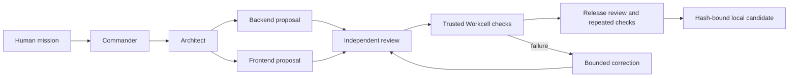

# Architecture and authority

- `bin/software-factory.mjs` is the normal entry point and runs doctor before model-backed execution.
- `factory/cli.mjs` creates run state and a workflow. `factory/dispatch.kujo` imports the pinned native Dispatch engine and permits bounded independent steps to overlap.
- `factory/worker.mjs` uses canonical Chain of Command role instructions with a fixed structured-output schema. Codex tools, apps and web search are disabled. Only scoped proposals are admitted.
- `factory/core.mjs` owns bounded subprocesses, journals, source digests and path admission.
- `factory/workcell.mjs` owns isolated leases, observed-policy checks, fixed HTTP bridging and protected report collection. `factory/workcell-image/` holds the trusted initializer, build/browser controls and independent watchdog.
- `factory/acceptance.mjs` is the controller-owned API oracle; candidates cannot edit it. Release repeats acceptance and binds its results to the source and trusted harness hashes.
- `factory/web/` is an independent read-only observer. Agent City packages, gateway, state, user interface and configuration are not imported.

Generated files, mission text and provider responses are untrusted. Host control code, dependency pins, image construction, Docker/VM and authentication remain trusted. The model's review is one input to the gate; it is not execution evidence.

Provider credentials stay in the controller's private `.runtime/provider/` home. No user home, provider credentials, Docker socket or host evidence directory is mounted into a candidate. Changing the deployment or sharing model requires a new threat assessment; this is a single local operator design.
