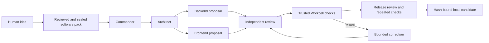

# Architecture and authority

- `bin/software-factory.mjs` is the normal entry point and runs doctor before model-backed execution.
- `factory/cli.mjs` creates run state and a workflow. `factory/dispatch.kujo` imports the pinned native Dispatch engine and permits bounded independent steps to overlap.
- `factory/worker.mjs` uses canonical Chain of Command role instructions with a fixed structured-output schema. Codex tools, apps and web search are disabled. Only scoped proposals are admitted.
- `factory/core.mjs` owns bounded subprocesses, journals, source digests and path admission.
- `factory/workcell.mjs` owns isolated leases, observed-policy checks, fixed HTTP bridging and protected report collection. `factory/workcell-image/` holds the trusted initializer, build/browser controls and independent watchdog.
- `factory/pack.mjs` validates packs and their frozen hashes. `factory/pack-acceptance.mjs` checks API results through Workcell; the image-owned `pack-browser.mjs` interprets browser steps. Packs contain data, never executable plugins.
- `factory/acceptance.mjs` remains the default issue-tracker API oracle; candidates cannot edit it. Release repeats acceptance and binds its results to the source and trusted harness hashes.
- `factory/web/` is an independent read-only observer. Agent City packages, gateway, state, user interface and configuration are not imported.

Generated files, mission text and provider responses are untrusted. Host control code, dependency pins, image construction, Docker/VM and authentication remain trusted. A model review is one input to the release gate. It is not evidence that tests ran. The setup agent reviews the pack before construction; the pack hash binds later checks and release. A seal proves byte identity, not test quality.

Provider credentials stay in the controller's private `.runtime/provider/` home. No user home, provider credentials, Docker socket or host evidence directory is mounted into a candidate. Changing the deployment or sharing model requires a new threat assessment; this is a single local operator design.

The integration increment adds `catalog.mjs` for pinned complete packages and canonical contract validation, `selection.mjs` for advisory team policies, `evidence.mjs` for standalone bounded offline verification and signatures, `provenance.mjs` for execution-start controller identity, and `mcp.mjs` for local read-only discovery. Factory Floor exposes catalog metadata through GET `/api/catalog`; no control endpoints were added. These modules do not replace native Dispatch or release authority.

`lifecycle.mjs` starts native RunLedger before implementation, captures failures through CaseFile, and derives final accounting only from controller records. `evaluation.mjs` runs fixed file-only native Eval suites over independent verification evidence. `release-policy.mjs` checks reviewed policy, actual selected ShipCheck observations and immutable test/source identities before and after independent release review. The worker stages a verified candidate; only the controller promotes it after accounting and identity rechecks. The standalone evidence verifier is shared by export, audit and recheck for new-format native gate consistency.

`role-runtime.mjs` derives required deliverables directly from canonical manifests. Controller-selected consultations surround the existing native Dispatch application graph, with verification consultations after trusted acceptance. Skills enter bounded work orders as pinned guidance; effect admission remains controller-owned. `spec-pipeline.mjs` selects a separate fixed Dispatch worker for draft specification review without software-release authority.

`repository-mission.mjs` admits a committed supported Node snapshot into a fresh private worktree, verifies it with the same independent gates, and prepares a local diff. `context.mjs` and `change-tools.mjs` call pinned native tools on bounded snapshots. `lens.mjs` binds native visual observations and Workcell policy identities to release-gates/v3. `cli-runtime.mjs` qualifies separate reviewed standard-library CLI cases without treating them as an application release.

`operations.mjs` binds initial configuration, specification, controller and workflow identities before Dispatch and inspects native recovery plans. It cannot replay uncertain fixed-name worker effects. `control-mcp.mjs` offers separately granted owned-mission operations over local stdio; the observer remains read-only. `maintenance.mjs` observes upstream drift without installing or authorizing updates.

`telemetry.mjs` projects bounded content-free terminal observations through pinned Watchdog normalization, validation and SQLite storage. The optional observer cannot change mission status or release authority; it does not run a proxy or external exporter.
