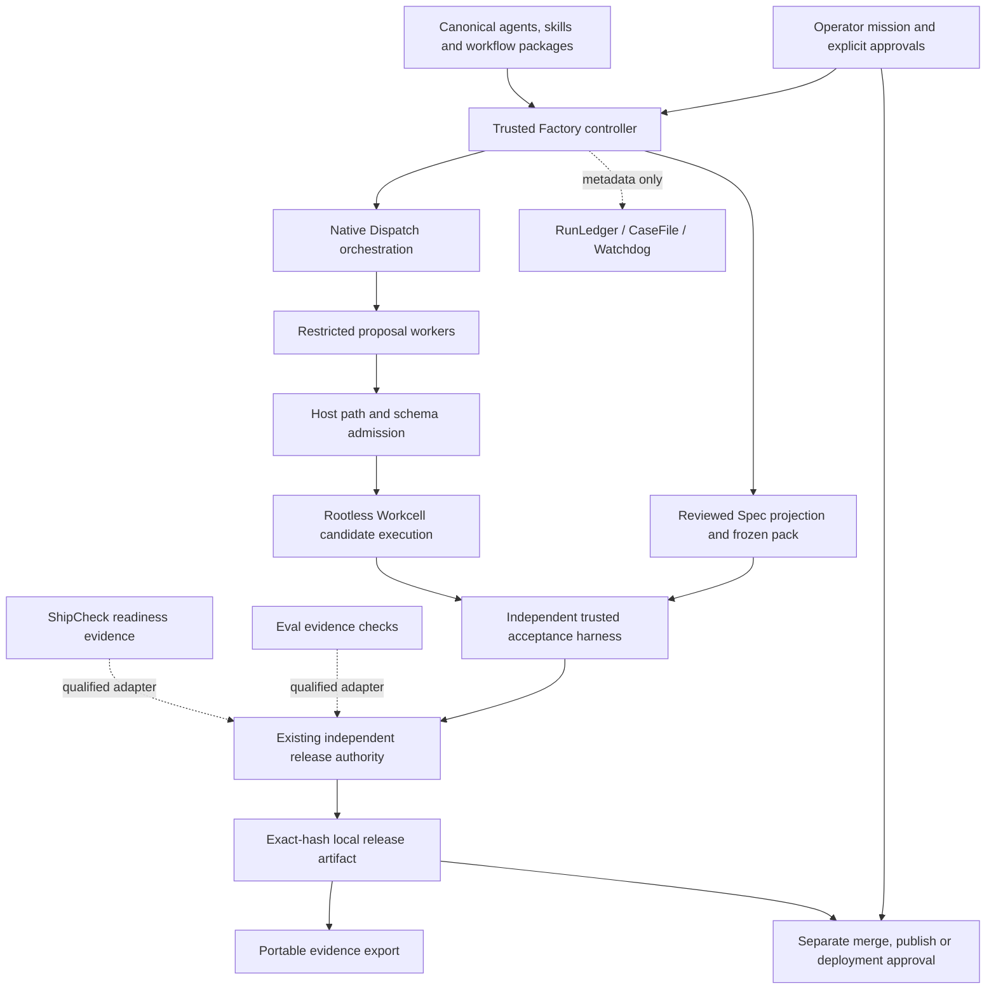

# Dependency and authority map

This map describes the audited baseline and the integration path. It does not promote optional or experimental components into installed release gates. Exact source pins and dependency edges live in [factory-capabilities.json](../config/factory-capabilities.json); installed dependencies remain separately controlled by lockfiles.

| Component | Owns | Must not own |
|---|---|---|
| Operator/controller | Mission authority, admitted files/tools, trusted policy, approval identity | Unbounded authority delegated by mission text or skills |
| Canonical role/skill catalogs | Instructions, schemas, discovery and capability descriptions | Host permissions, test modification or release approval |
| Spec / frozen pack | Requirement identity, validation and test traceability data | Semantic correctness merely from a seal |
| Dispatch | Dependencies, bounded retries, durable run state, recovery decisions | Replaying uncertain irreversible effects without reconciliation |
| Workcell | Qualified execution boundary, runtime policy and receipts | Declaring application correctness or authorizing deployment |
| Provider/Agents SDK | Model transport, normalized output, explicit capabilities and usage | Approving its own implementation or turning model claims into tests |
| Trusted tests / Eval | Actual checks and evidence evaluation | Untrusted host commands or model-based substitutes for execution |
| ShipCheck / Fence / Concord / ChangeBucket | Readiness, architecture, drift and footprint observations | Sandbox enforcement, complete security proof or independent deployment permission |
| Release gate | Exact-source local candidate decision after independent checks | Merge, publish, production deployment or external writes |
| RunLedger / CaseFile / Watchdog | Accounting, retained failures, observational telemetry | Fabricated usage, success, test execution or retry authorization |
| Scout / Scent / Redact / RAG / optional Strata | Scoped context, source references, selective knowledge and redaction aids | Trusted instructions derived from repository text or perfect secret detection |
| Ability / MCP | Versioned operation exposure, bounded authenticated invocation | Generic shell, blanket network/container access or caller-asserted authority |
| Relay / Tribunal / VersionSeal / Source | Explicit interoperable mission/decision/approval/proposal artifacts | Competing implicit release authority inside Factory |
| Factory Floor | Read-only status, evidence, artifacts and replay | State-changing endpoints under the viewer identity |

## Dependency closure and optional services

The existing closure is Node 26, pinned npm Kujo runtime/Codex/Ajv, and exact Dispatch, Workcell and Kujo Agents source pins. Catalog packages should be installed at exact source commits with all resources and upstream licenses intact. Optional tool closures must have their own verified pins and explicit diagnostics. An audited latest source head is not automatically an installed upgrade.

AI SDK and native provider adapters are the supported integration candidates for provider neutrality. OpenAI, Anthropic, Gemini and Ollama have distinct protocols and capabilities. Other provider packages include media-specific operations; package presence does not qualify text generation or structured-output roles. No provider is promoted by a mock. Unknown token/cost data remains unknown.

Ability Gateway requires Cloudflare and remote identity; it is optional, never required for local operation. Hosted retrieval, external Watchdog exporters, remote Workcell providers, PostgreSQL, GitHub writes and deployments need separate opt-in and qualification. Kujo Foreman is excluded. Agent City, BZBY and commercial services are not dependencies.

## Safe adapter rules

1. Invoke exact pinned canonical entry points with fixed argv, deadlines, output caps and a minimal environment. Reject unknown tools, user-controlled executable names and unsafe paths.
2. Controller-created inputs and reports live outside candidate writable roots. Never execute candidate scripts through Eval, Muzzle, CaseFile, a workflow kit, an MCP server or package lifecycle hooks on the host.
3. Spec projections retain the original frozen pack hash. Acceptance is authored/reviewed independently; validators prove format, not requirement quality.
4. RunLedger records observed outcomes and sourced usage; CaseFile captures retained failure logs without rerunning candidate commands. A later retry never deletes the failed attempt.
5. A source hash proves integrity. Authentication requires a separately trusted signing key and verified signature; neither alone proves execution, correctness, human identity or deployment authority.
6. Recovery uses Dispatch primitives. An uncertain external effect requires reconciliation and fresh explicit authority; stale approvals are never inherited by changed source/spec/harness/image identities.
7. Drift detection reports upstream catalog, schema and dependency changes. It does not adopt them without review and rerunning compatibility/security qualification.

## Remaining implementation dependencies

The source audit enables catalog and evidence work immediately. Full lifecycle routing, provider conformance, new runtime images, authenticated MCP mutations, recovery and clean-platform qualification remain distinct acceptance work. Every required integration needs a real executable test and retained evidence before its release requirement can be marked complete. See the release qualification and continuation reports for implementation status after this baseline audit.
